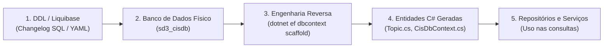

# Entity Framework Core: Code First vs Database First

## 1. Introdução

No desenvolvimento de aplicações corporativas com .NET e Entity Framework Core (EF Core), a sincronização entre as classes do modelo de domínio em C# e o esquema do banco de dados relacional é um aspecto crítico de arquitetura e governança de dados.

O EF Core oferece duas abordagens fundamentais para modelagem e persistência:
* **Code First:** O código C# é a fonte primária da verdade, e o esquema do banco de dados é gerado e atualizado a partir das classes e migrações do EF Core.
* **Database First:** O banco de dados é a fonte primária da verdade, e as classes de entidade e o contexto (`DbContext`) são criados ou atualizados a partir do esquema físico existente.

O objetivo deste Spike é investigar detalhadamente os conceitos, fluxos de trabalho, vantagens, limitações e impactos arquiteturais de cada abordagem, estabelecendo diretrizes práticas para a **CIS API** e definindo a convivência com o versionamento de banco já adotado no projeto via **Liquibase**.

---

## 2. Abordagem Code First

### 2.1 Conceito e Filosofia
Na abordagem Code First, os desenvolvedores definem as entidades de domínio, propriedades e relacionamentos utilizando código C# puro e a API fluente (`Fluent API` / `ModelBuilder`) do EF Core. O desenvolvedor raramente escreve comandos DDL manuais (`CREATE TABLE`, `ALTER TABLE`), delegando a geração e o rastreamento dessas mudanças para as migrações do EF Core (*EF Core Migrations*).

### 2.2 Fluxo de Trabalho (Workflow)


1. **Modelagem:** Criação ou alteração das entidades C# e mapeamento no `OnModelCreating` do `DbContext`.
2. **Criação da Migração:** Execução do comando via terminal:
   ```bash
   dotnet ef migrations add AddTopicsTable --project src/Cis.Infrastructure.MySql --startup-project src/Cis.Server
   ```
   O EF Core compara o modelo de código atual com um snapshot anterior e gera uma classe de migração contendo os métodos `Up()` (aplicar) e `Down()` (reverter).
3. **Aplicação das Alterações:** Atualização física do banco de dados:
   ```bash
   dotnet ef database update
   ```
   Ou geração do script SQL correspondente para revisão e execução controlada:
   ```bash
   dotnet ef migrations script
   ```

### 2.3 Gestão de Esquema e Modelos
* **Fonte da Verdade:** O código-fonte C# no repositório Git.
* **Controle de Histórico:** O EF Core cria e mantém uma tabela de controle chamada `__EFMigrationsHistory` no banco de dados, registrando o identificador de cada migração aplicada.

### 2.4 Vantagens e Considerações
* **Vantagens:**
  * Fluxo natural para desenvolvedores .NET, focado inteiramente em C#.
  * Suporte robusto a Domain-Driven Design (DDD), permitindo encapsulamento, invariantes e classes imutáveis.
  * Migrações versionadas como arquivos C# diretamente no Git.
* **Considerações e Riscos:**
  * Menos controle granular sobre recursos específicos do MySQL (como engines de armazenamento, índices espaciais, triggers e particionamento).
  * Potencial complexidade de merge de migrações quando múltiplos desenvolvedores criam migrações paralelas na mesma branch.

---

## 3. Abordagem Database First

### 3.1 Conceito e Filosofia
Na abordagem Database First, o banco de dados é projetado e mantido em primeiro lugar. O esquema físico das tabelas, chaves primárias, chaves estrangeiras, restrições e índices é criado diretamente no MySQL (ou por ferramentas externas de migração DDL como Liquibase ou Flyway). Em seguida, utiliza-se a ferramenta de engenharia reversa do EF Core (*Scaffolding*) para gerar as classes C# e o `DbContext`.

### 3.2 Fluxo de Trabalho (Workflow)



1. **Alteração do Esquema:** O esquema é criado ou atualizado no banco de dados através de scripts SQL ou migrações do Liquibase.
2. **Engenharia Reversa (Scaffolding):** Execução do comando do EF Core para inspecionar o catálogo do MySQL e gerar o código C#:
   ```bash
   dotnet ef dbcontext scaffold "Server=sd3db;Port=3306;Database=sd3_cisdb;User=change_me;Password=change_me;" Pomelo.EntityFrameworkCore.MySql \
       --project src/Cis.Infrastructure.MySql \
       --output-dir Entities \
       --context CisDbContext \
       --context-dir Context \
       --force
   ```
3. **Utilização:** As classes geradas são utilizadas para compor as operações de consulta e persistência.

### 3.3 Gestão de Esquema e Modelos
* **Fonte da Verdade:** O esquema do banco de dados relacional.
* **Controle de Histórico:** Gerenciado externamente (no caso da CIS API, pela tabela `DATABASECHANGELOG` do Liquibase).

### 3.4 Vantagens e Considerações
* **Vantagens:**
  * Controle absoluto sobre as definições DDL do banco de dados e otimizações específicas do MySQL.
  * Integração perfeita com ferramentas corporativas de migração e governança de banco de dados (Liquibase, Flyway).
  * Excelente para bancos de dados legados ou compartilhados entre múltiplos serviços.
* **Considerações e Riscos:**
  * O comando `--force` do scaffold sobrescreve as classes geradas, o que pode apagar métodos manuais adicionados pelo desenvolvedor (exige uso disciplinado de classes parciais `partial class`).
  * As entidades geradas pelo scaffold costumam ser estruturas anêmicas com getters e setters públicos, distanciando-se de entidades ricas de domínio.

---

## 4. Matriz Comparativa Detalhada

A tabela a seguir resume as principais diferenças práticas e conceituais entre as duas abordagens:

| Critério de Comparação | Code First (EF Core) | Database First (Scaffold / DDL) |
| :--- | :--- | :--- |
| **Fonte Primária da Verdade** | Classes C# e `DbContext` no código. | Esquema do banco de dados relacional / Changelogs DDL. |
| **Criação de Tabelas e Colunas** | Automatizada via `dotnet ef database update`. | Manual via SQL ou automatizada via Liquibase / Flyway. |
| **Mecanismo de Histórico** | Tabela interna `__EFMigrationsHistory`. | Tabela `DATABASECHANGELOG` (Liquibase) ou controle do DBA. |
| **Controle de DDL e Otimizações** | Limitado aos recursos suportados pela Fluent API. | Total: permite views, triggers, índices compostos e dialetos nativos. |
| **Aderência a Clean Architecture** | Alta: o modelo de domínio orienta a persistência. | Moderada: risco de acoplar o domínio à estrutura física da tabela. |
| **Sobrescrita de Código** | Não sobrescreve código; adiciona arquivos de migração. | A reexecução do scaffold pode sobrescrever customizações manuais. |
| **Ambientes com Liquibase/Flyway** | Alto risco de conflito de governança de migrações. | Integração limpa e natural com esteiras automatizadas de DDL. |
| **Curva de Aprendizado** | Baixa para quem domina ecossistema .NET. | Baixa para quem domina modelagem relacional SQL e DDL. |

---

## 5. Considerações Arquiteturais e de Manutenibilidade na CIS API

A análise técnica deste Spike identificou três restrições fundamentais no contexto do projeto CIS:

### 5.1 O Impacto da Adoção Prévia do Liquibase
Na Sprint 5 e Sprint 6, a equipe implementou e homologou o **Liquibase** no repositório `cis-api` (diretório `Data/`) para versionar as tabelas do banco `sd3_cisdb` (`00001-create_database_tables.sql`).
* Se a equipe adotasse o **Code First puro** com *EF Migrations*, haveria uma sobreposição destrutiva de ferramentas: o Liquibase e o EF Core tentariam controlar o esquema simultaneamente, gerando inconsistências entre `DATABASECHANGELOG` e `__EFMigrationsHistory`.
* Portanto, **o Liquibase deve ser o único responsável pelo ciclo de vida DDL do banco**.

### 5.2 Preservação do Isolamento do Core Domain na Clean Architecture
No projeto `cis-api`, a solução foi estruturada com isolamento rigoroso:
* `Cis.Core.Domain`: Não possui dependências do Entity Framework nem anotações de persistência.
* `Cis.Infrastructure.MySql`: Responsável pela infraestrutura de acesso ao banco e mapeamento.
* Se utilizássemos o comando automático de engenharia reversa (`dotnet ef dbcontext scaffold`), o EF Core geraria as classes de entidade acopladas a seu contexto, violando a pureza do domínio ou forçando a geração das entidades fora da pasta `Domain`.

### 5.3 O Padrão Híbrido: Database-First na Infraestrutura com Mapeamento Manual
Para obter o melhor dos dois mundos, o padrão recomendado para o projeto é o **Database First com Mapeamento Fluente Manual**:
1. O **Liquibase** cria as tabelas no MySQL a partir dos changelogs versionados.
2. Os desenvolvedores modelam as classes de domínio puras em `Cis.Core.Domain/Entities/`.
3. No projeto `Cis.Infrastructure.MySql`, cria-se o `CisDbContext` e classes de configuração (`IEntityTypeConfiguration<T>`) mapeando explicitamente cada entidade para as tabelas criadas pelo Liquibase (nomes de tabela, tipos de coluna, chaves primárias e chaves estrangeiras).
4. **Nenhuma migração do EF Core é gerada**, eliminando o risco de duplicidade de ferramentas.

---

## 6. Decisão Arquitetural da Equipe

Com base nas análises efetuadas, a equipe definiu a seguinte diretriz arquitetural para a CIS API:

> **Decisão:** A equipe adotará a abordagem **Database-Driven com Liquibase e Mapeamento Manual via Fluent API no EF Core**.

### Justificativas da Decisão:
1. **Governança Unificada de Banco de Dados:** O Liquibase permanece como a única fonte da verdade e ferramenta oficial para criação, alteração e rollback de estruturas de banco de dados (`sd3_cisdb`), garantindo paridade com os padrões corporativos ensinados na disciplina.
2. **Conformidade Estrita com Clean Architecture:** As entidades de negócio residem puras em `Cis.Core.Domain`, e o mapeamento relacional é isolado no projeto `Cis.Infrastructure.MySql` através de classes de configuração que implementam `IEntityTypeConfiguration<Topic>`, sem gerar código temporário de migração.
3. **Ausência de Conflitos em CI/CD:** O pipeline do GitLab CI não precisará executar `dotnet ef database update`, pois o banco de dados e as migrações são orquestrados separadamente via Docker Compose e containers do Liquibase.

---

## 7. Perguntas Abertas, Premissas e Próximos Passos

### 7.1 Perguntas Abertas
* **Validação de Sincronismo:** É possível criar um teste automatizado de integração que verifique se o modelo do `CisDbContext` está em perfeita conformidade com o esquema físico criado pelo Liquibase, alertando caso falte alguma coluna mapeada?
* **Estratégia de Seeds de Desenvolvimento:** Os dados iniciais de teste (*seed data*) devem ser injetados via changelogs específicos do Liquibase ou via método `HasData()` do EF Core?

### 7.2 Premissas Assumidas
* As migrações do Liquibase sempre serão executadas antes da inicialização da API em qualquer ambiente (local, container ou homologação).
* As dependências do EF Core (`Pomelo.EntityFrameworkCore.MySql`) ficarão restritas exclusivamente ao projeto `Cis.Infrastructure.MySql`.

### 7.3 Próximos Passos
1. Atualizar o sumário de Spikes (`Spikes.md`) com o status de conclusão e decisão deste documento.
2. Implementar a classe `CisDbContext` no projeto `Cis.Infrastructure.MySql` mapeando a entidade `Topic` para a tabela `topics` existente.
3. Substituir o stub de `TopicRepository.cs` para consumir o `CisDbContext` com suporte a consultas assíncronas (`ToListAsync`).

